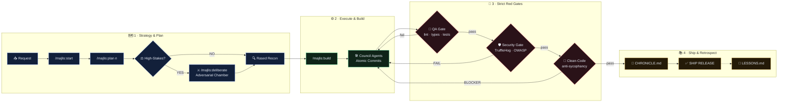

<div align="center">

[](USAGE_AR.md)
[](USAGE_EN.md)
[](USAGE_ZH.md)

# 🏛️ MAJLIS · The Council — المجلس

### **One mind. Every tool. — عقلٌ واحد في كل أدواتك — 一个大脑，贯通所有工具**


<p align="center">
  <b>A battle-tested multi-agent cognitive architecture and autonomous governance framework for AI coding editors.</b><br>
  Forty specialized agents, 91 curated trilingual skills, 7 governing commands, a red security gate, and an adversarial System-2 deliberation war-room.<br>
  <i>Installed in seconds into OpenCode, Claude Code, Codex, Antigravity, Cursor, Windsurf, and 26+ platforms.</i>
</p>

```bash
git clone https://github.com/1stANUNNAKI/majlis.git
cd majlis
powershell -File install_system.ps1    # Or: node npm/bin/install.js --all
```

</div>

---

## 📑 Table of Contents · المحتويات · 目录

- [🌟 Overview · نظرة عامة](#-overview--نظرة-عامة)
- [🚀 Quick Start Guide · دليل الاستخدام السريع](#-quick-start-guide--دليل-الاستخدام-السريع)
  - [1. Clone & Setup](#1-clone--setup)
  - [2. Deploy to Your IDE](#2-deploy-to-your-ide)
  - [3. Run the Automated Pipeline](#3-run-the-automated-pipeline)
  - [4. The Adversarial War-Room (MARP)](#4-the-adversarial-war-room-marp)
  - [5. Explore the 3D Interactive World](#5-explore-the-3d-interactive-world)
  - [6. Integrity Verification](#6-integrity-verification)
- [🏛️ The Council of Forty · المجلس الأربعيني](#️-the-council-of-forty--المجلس-الأربعيني)
- [⚡ Seven Governing Commands · الأوامر الحاكمة السبعة](#-seven-governing-commands--الأوامر-الحاكمة-السبعة)
- [⚖️ Dual-Mode Execution Matrix · قانون التناسب المعماري](#️-dual-mode-execution-matrix--قانون-التناسب-المعماري)
- [🔄 The Pipeline & Red Gate · خط الإنتاج والبوابة الحمراء](#-the-pipeline--red-gate--خط-الإنتاج-والبوابة-الحمراء)
- [🧠 Skills Ecosystem (91 Trilingual) · المهارات](#-skills-ecosystem-91-trilingual--المهارات)
- [🌐 Supported Platforms (26+) · المنصات المدعومة](#-supported-platforms-26--المنصات-المدعومة)
- [📁 Repository Structure · هيكلية المستودع](#-repository-structure--هيكلية-المستودع)
- [📜 License & Citation · الترخيص](#-license--citation--الترخيص)

---

## 🌟 Overview · نظرة عامة

**MAJLIS (المجلس)** gives your AI coding assistant a real boss, an offensive security officer, an architectural arbitrator, and an uncompromising code reviewer.

Instead of a single AI model hallucinating self-approvals, **Majlis orchestrates 40 real specialized agents** divided into 6 strategic divisions. Every code release must pass through runnable verification contracts, an anti-sycophancy review panel, a zero-trust red gate, and a persistent chronological memory.

> [!NOTE]
> **No Hallucinated Passes:** In Majlis, "looks good to me" is forbidden. Nothing ships without real terminal execution proof (`verify: PASS`).

---

## 🚀 Quick Start Guide · دليل الاستخدام السريع

Follow these simple steps to run and integrate Majlis as a standalone repository on your machine:

### 1. Clone & Setup
Clone the repository and inspect the codebase:
```bash
git clone https://github.com/1stANUNNAKI/majlis.git
cd majlis
```

### 2. Deploy to Your IDE
Deploy the 40 agents, 91 skills, and governing commands directly into your editors:

| Goal | Command |
|---|---|
| **Deploy Everywhere (Recommended)** | `powershell -File install_system.ps1` *(or: `node npm/bin/install.js --all`)* |
| **Google Antigravity & Gemini CLI** | `node npm/bin/install.js --gemini` |
| **Claude Code** | `node npm/bin/install.js --claude` |
| **OpenCode** | `node npm/bin/install.js --opencode` |
| **Codex** | `node npm/bin/install.js --codex` |
| **Scaffold specific project (Cursor, VS Code, Windsurf)** | `node npm/bin/install.js --scaffold <path-to-your-project>` |

### 3. Run the Automated Pipeline
Run the autonomous end-to-end pipeline on any software directive:
```bash
node run.js "Build a modern responsive dashboard with auth and audit logging"
```
The orchestrator routes the task through the proper divisions, checks historical lessons in memory, coordinates agent execution, and runs the interactive QA validation loop.

### 4. The Adversarial War-Room (MARP)
Before making high-stakes, breaking, or critical architectural choices, invoke the **Majlis Adversarial Reasoning Protocol (MARP)**:
```bash
node run.js --deliberate "Design high-throughput banking ledger with zero-trust RBAC"
```
**What happens in the chamber:**
1. **The Domain Specialist:** Deconstructs the challenge from First Principles and calculates 2nd-order catastrophic effects.
2. **The Engineer:** Proposes the structural architecture.
3. **The Devil's Advocate:** Mandatorily rejects the initial draft and extracts at least one structural fatal flaw.
4. **The Pragmatic User:** Ruthlessly stress-tests usability and rejects artificial complexity.
5. **The Maestro:** Issues the pristine, final, unarguable implementation ready for execution.

### 5. Explore the 3D Interactive World
Majlis features a world-class 3D visualization running directly in your browser:
* Double-click **[`majlis_interactive_city.html`](majlis_interactive_city.html)** or serve it locally.
* **Features:** Built with **Three.js** and **GSAP** over the **Great 3D Topographical Map of Iraq** (Tigris, Euphrates, Mountain ranges, and Shatt al-Arab).
* Explores the **6 Continents**, **40 articulated 3D agent characters**, and interactive live flight simulation of multi-agent tasks in real time.

### 6. Integrity Verification
Ensure your installation meets 100% architectural and security standards:
```bash
# Full test suite (1729 strict assertions)
node eval/run.js

# Benchmark speed and memory footprint
node run_benchmark_suite.js
```

---

## 🏛️ The Council of Forty · المجلس الأربعيني

> Full bilingual roster, agent definitions, tools, and output contracts: **[COUNCIL.md](COUNCIL.md)**

```
                                 ┌───────────────────┐
                                 │   👑 COMMAND &    │
                                 │     STRATEGY      │
                                 │    @hadi-core     │
                                 └─────────┬─────────┘
                                           │
         ┌───────────────────┬─────────────┴─────────────┬───────────────────┐
         │                   │                           │                   │
┌────────┴────────┐ ┌────────┴────────┐         ┌────────┴────────┐ ┌────────┴────────┐
│  🔍 RECON &     │ │  ⚙️ BUILDERS &   │         │  🛡️ GATES &     │ │  🎨 EXPERIENCE  │
│     RISK        │ │   ENGINEERING   │         │    SECURITY     │ │   & IDENTITY    │
│ @rased-explorer │ │  @emad-shield   │         │ @sareem-security│ │ @design-system  │
│  @risk-assessor │ │  @data-modeler  │         │    @baher-qa    │ │ @bayan-diagrams │
│ @incident-detect│ │ @integrative-arc│         │@nadif-clean-code│ │@responsive-layou│
└─────────────────┘ └─────────────────┘         └─────────────────┘ └─────────────────┘
                                           │
                                 ┌─────────┴─────────┐
                                 │  📚 KNOWLEDGE &   │
                                 │    OPERATIONS     │
                                 │  @sajeel-logger   │
                                 │   @hakim-mentor   │
                                 └───────────────────┘
```

| Division | Seats | Core Mission |
|---|---|---|
| 👑 **Command & Strategy** (3) | `@hadi-core` · `@hadi-maestro` · `@product-shaper` | Strategic arbitration, mission decomposition, and requirement sharpening. |
| 🔍 **Recon & Risk** (3) | `@rased-explorer` · `@risk-assessor` · `@incident-detective` | Pre-execution codebase reconnaissance, blast-radius pricing, and root-cause analysis. |
| ⚙️ **Builders & Engineering** (10) | `@emad-api-shield` · `@data-modeler` · `@integrative-architect` · `@stream-partitioner` · `@dep-manager` · `@cicd-automator` · `@sandbox-isolator` · `@motion-coder` · `@data-engineer` · `@release-manager` | Modular backend defenses, robust data schemas, clean integrations, and container sandbox executions. |
| 🚦 **Quality & Security Gates** (7) | `@sareem-security` · `@baher-qa` · `@nadif-clean-code` · `@code-polisher` · `@test-engineer` · `@perf-auditor` · `@a11y-auditor` | The Red Gate, zero-trust secrets sweep, unit/regression test harnesses, and clean code enforcement. |
| 🎨 **Experience & Identity** (8) | `@bayan-diagrams` · `@design-system-master` · `@responsive-layout` · `@ux-researcher` · `@brand-guardian` · `@print-publisher` · `@growth-analyst` · `@cinematic-director` | Multi-device layout responsiveness, HSL tokens, 3D motion, clear Mermaid visuals, and UX evidence. |
| 📚 **Knowledge & Operations** (9) | `@sajeel-logger` · `@hakim-mentor` · `@balegh-docs` · `@mubtakir-tools` · `@agent-weaver` · `@prompt-smith` · `@context-steward` · `@portfolio-steward` · `@voice-engineer` | Historical memory, real timestamp logging, tool synthesis, and dynamic subagent weaving. |

---

## ⚡ Seven Governing Commands · الأوامر الحاكمة السبعة

Available natively per platform (e.g. Claude `/majlis:start`, Codex `/prompts:majlis-start`, Gemini CLI `/majlis:start`, or natural language: *"run majlis deliberate"*):

| Command | Action | Enforced Gate |
|---|---|---|
| `/majlis:start` | Initializes guided governance, `.majlis/` project constitution, and roadmap. | Mandatory setup |
| `/majlis:plan <n>` | Decomposes phase into atomic waves with runnable verification contracts. | No-verify plans rejected |
| `/majlis:build` | Executes parallel waves via specialized council agents with atomic commits. | Forbidden globs & test checks |
| `/majlis:review` | Independent 2–4 reviewer panel applying anti-sycophancy rubrics. | Blocker bounces (≤3 cycles) |
| `/majlis:deliberate` | **NEW:** Closed Adversarial War-Room (MARP-V1) for high-stakes decisions. | Mandatory fatal flaw extraction |
| `/majlis:security` | Offensive security audit: TruffleHog secrets → Nuclei → OWASP ZAP. | **SECURITY: PASS** mandatory |
| `/majlis:status` | Live dashboard showing milestone progress and exact next action. | Read-only |

---

## ⚖️ Dual-Mode Execution Matrix · قانون التناسب المعماري

To eliminate friction and avoid unnecessary bureaucracy, Majlis operates on a **Dual-Mode Proportional Matrix**:

```
                       ┌────────────────────────────────────────┐
                       │           INCOMING DIRECTIVE           │
                       └───────────────────┬────────────────────┘
                                           │
                        Is it a targeted bugfix / local edit?
                                  (Touches < 3 files)
                                  /                 \
                                YES                  NO
                                /                     \
             ┌─────────────────────────┐   ┌─────────────────────────┐
             │  ⚡ FAST-PATH / HOTFIX   │   │  🏛️ MAJOR ARCHITECTURE  │
             ├─────────────────────────┤   ├─────────────────────────┤
             │ • Immediate clean code  │   │ • Full Council activation│
             │ • No 14-doc ceremony    │   │ • Scaffolding & PRD     │
             │ • Guard Clauses & SRP   │   │ • 14 Architecture docs  │
             │ • verify: PASS contract │   │ • Adversarial Chamber   │
             │ • Zero developer latency│   │ • CHRONICLE.md logging  │
             └─────────────────────────┘   └─────────────────────────┘
```

---

## 🔄 The Pipeline & Red Gate · خط الإنتاج والبوابة الحمراء



### 🚨 The Signature Red Gate
Before any release is signed off, the offensive security pipeline executes:
1. **Secrets Sweep:** TruffleHog checks git tree and environment files.
2. **Vulnerability Audit:** Nuclei templates scan configuration exposure.
3. **API Defense:** OWASP ZAP tests dynamic endpoint protection.
4. **Binary Verdict:** A single security failure halts the entire release.

---

## 🧠 Skills Ecosystem (91 Trilingual) · المهارات

Every skill includes complete documentation in **English · العربية · 中文**:
Explore the full catalog in **[SKILLS_CATALOG.md](SKILLS_CATALOG.md)**.

| Category | Count | Focus |
|---|---|---|
| 🛡️ **Security & Auditing** | 6 | `trufflehog-secret-scanner`, `nuclei-security-auditor`, `owasp-zap-api-shield`, `security-clean-code-auditor`, `k6-load-testing` |
| 🏛️ **Council & Architecture** | 21 | `maestro-hadi-orchestration`, `integrative-architect-docs`, `chronicle-logger-timestamp`, `intent-observer-audit360` |
| 🔬 **Bio & Science Databases** | 35 | `uniprot-database`, `alphafold-database`, `pubmed-database`, `ensembl-database`, `gnomad-database`, `chembl-database` |
| 🎨 **Creative & Visual Motion** | 13 | `remotion-video-engine`, `cinematic-animator-gsap`, `design-system-master-hsl`, `responsive-layout-engine` |
| ☁️ **Cloudflare & Edge Stack** | 14 | `cloudflare`, `wrangler`, `durable-objects`, `turnstile-spin`, `cloudflare-email-service` |
| 🧰 **Meta, SDKs & Tooling** | 2 | `google-antigravity-sdk`, `uv` |

---

## 🌐 Supported Platforms (26+) · المنصات المدعومة

| Tier | Editors & Environments | Capabilities |
|---|---|---|
| 🟢 **Native Subagents** | OpenCode · Claude Code | 40 isolated subagents, automatic skill routing, native slash commands. |
| 🟡 **Prompt & Command Native** | Google Antigravity · Gemini CLI · OpenAI Codex | System-2 Kernel, `$skills`, `/majlis:*` commands, global customization. |
| 🔵 **Rules & Scaffolding** | Cursor · Windsurf · GitHub Copilot · VS Code · Aider · Zed · 20+ more | Self-contained `.majlis/` rules, `.cursorrules`, `.windsurf/rules`, `.agents/skills`. |

---

## 📁 Repository Structure · هيكلية المستودع

```text
├── agents/                         # 40 Specialist Agent Markdown definitions
├── commands/                       # 7 Governing platform commands (/majlis:*)
├── core_orchestrator/              # Supreme Orchestrator & Adversarial Chamber Engine
│   ├── orchestrator.js             # Pipeline routing and division dispatch
│   └── adversarial_chamber.js     # MARP-V1 closed war-room engine
├── divisions/                      # Division engines (QA, Design, Web, Mobile...)
├── memory/                         # Persistent agent memory & historical lessons
├── npm/                            # Standalone distributable package (npm/pnpm)
│   └── bin/install.js              # Universal multi-platform installer
├── skills/                         # 91 curated trilingual skill modules
├── templates/                      # Governing constitutions & System-2 prompt rules
│   ├── ADVERSARIAL_CHAMBER.prompt  # MARP war-room protocol
│   ├── MAJLIS_CORE_DIRECTIVES.md   # Core binding directives
│   └── project-rules.md            # Lightweight project rules template
├── eval/run.js                     # 1729 automated integrity assertions
├── run.js                          # Unified pipeline & CLI runner
├── run_benchmark_suite.js          # Speed & memory benchmark suite
├── index.html                      # Interactive multilingual landing presentation
├── majlis_interactive_city.html    # 3D Interactive World over the Map of Iraq
├── majlis_interactive_data.js      # 3D dataset (40 agents, 91 skills, 6 continents)
├── COUNCIL.md                      # Full bilingual roster of the 40 seats
├── SKILLS_CATALOG.md               # Complete catalog of 91 skills
├── CHRONICLE.md                    # Immutable chronological engineering record
└── LESSONS.md                      # Distilled architectural lessons learned
```

---

## 📜 License & Citation · الترخيص

Distributed under the **MIT License**. Free for personal, enterprise, and educational use.

<div align="center">

**🏛️ MAJLIS · The Council**  
*Hunt first. Ship clean. — اصطد أولاً، وانشر نقياً — 先猎其弊，后出其器*

[⭐ Star this repo on GitHub](https://github.com/1stANUNNAKI/majlis)

</div>
